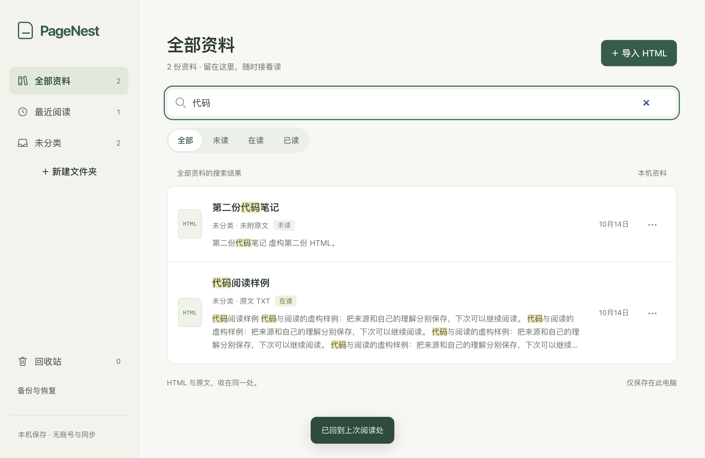

# PageNest

[](README.md) [](README.zh-CN.md)

把 HTML 资料收在一起，随时接着读。

PageNest 是一个本地优先的 HTML 阅读库。你可以导入已有的文章、学习笔记或 AI 整理页面，按文件夹归类、搜索正文、记录阅读进度和个人备注。当前提供 macOS Apple Silicon 桌面版，保留轻量的本机网页版。



*截图使用虚构资料；安装后从空库开始。*

## 能做什么

- **导入与分类**：单份或批量拖入 HTML，统一选择文件夹，重复资料自动跳过；PDF、TXT、HTML 原文和 HTTPS 来源链接可选。
- **文件夹管理**：侧栏或分类抽屉中，自定义文件夹旁的常显“⋯”可直接改名、删除。删除只把资料归入未分类，原内容保留；系统分类没有这些操作。
- **全文搜索**：检索标题与 HTML 静态正文，在结果标题和片段中高亮关键词。
- **继续阅读**：保存阅读位置，提供可收起的章节目录；HTML 与原文在同一条目中切换。
- **阅读状态**：未读、在读、已读，配合分类和搜索整理待读资料。
- **个人备注**：保存纯文本备注，将标题、来源、状态和备注导出为 Markdown，方便带入 Obsidian。
- **整库备份**：导出 `.pagenest` 文件，恢复时合并去重，保留已有资料。

所有资料保存在当前电脑。应用无需账号，也无需 API Key；HTML 可以由你使用的工具在软件外生成后导入。

## 使用桌面版

打开 `PageNest.app` 即可使用，自带运行环境，无需先启动终端服务。重复打开会唤起已有窗口；关闭窗口或退出应用会结束本地服务。未保存的编辑会提示确认。

**当前尚未在 GitHub 发布可下载的安装包。** 可按下方步骤从源码构建。当前交付范围为 macOS Apple Silicon；Intel Mac、Windows、Linux 尚未验证。

资料默认保存于：

```text
~/Library/Application Support/PageNest/library
```

推荐使用侧栏“备份与恢复”定期导出。更新应用不会自动删除该目录；桌面库与源码网页版的 `.data/` 各自独立，需要通过备份手动迁移。

## 从源码运行

需要 Node.js **22.13 或更新版本**、npm，以及首次安装依赖时的网络连接。

```sh
git clone https://github.com/Brandoo110/PageNest.git
cd PageNest
npm ci
PAGENEST_DESKTOP_DATA_DIR="$PWD/.data-desktop-dev" npm run desktop:dev
```

上述命令使用独立开发资料目录，避免改动日常桌面库。首次安装会下载 Electron 运行环境。

也可以运行本机网页版：

```sh
npm start
```

打开 `http://127.0.0.1:4173`，资料位于项目 `.data/`。应用仅监听本机回环地址；不支持直接向局域网或公网开放。

## 构建 macOS 安装包

在 macOS Apple Silicon 上安装依赖后执行：

```sh
npm run desktop:package
```

产物位于 `artifacts/desktop/build/`：

- `mac-arm64/PageNest.app`
- `PageNest-0.1.0-arm64.dmg`

当前构建使用 ad-hoc 签名，**未取得 Developer ID 签名与 Apple 公证**，其他电脑可能受到 Gatekeeper 限制。打包命令不会自动上传安装包；应用暂未提供自动更新。

## 使用前了解

- 优先导入自包含 HTML。外部图片、字体、脚本和复杂网页应用可能无法完整显示。
- 导入 HTML 在隔离沙箱中显示，原文件字节保留；仍应选择可信资料，脚本的 CPU 与内存消耗没有独立限额。
- 搜索仅覆盖标题与 HTML 静态正文，暂不包括 PDF/OCR、原文附件、备注或脚本生成的正文。目录来自静态章节标题。
- PDF 预览取决于运行环境；阅读进度仅记录手动页码，不保证页内位置恢复。桌面版“新窗口打开”会保存 PDF 文件。
- 备份包含完整原件与备注，**没有加密**。恢复采用合并模式，相同 HTML 整条跳过，不覆盖已有状态和备注。
- 暂未提供内置 AI、登录、同步、多级文件夹、云端服务或多人协作。

文件大小、批量导入、保存行为与备份格式见[使用与技术参考](docs/technical-reference.md)。

## 开发与参与

普通 HTML/CSS/JavaScript + Node HTTP + SQLite，桌面入口使用 Electron。无需前端打包框架。

- [贡献指南](CONTRIBUTING.md)：工作区、分支、提交与适度检查。
- [数据与安全说明](SECURITY.md)：隔离边界、隐私与问题报告。
- [更新记录](CHANGELOG.md)：当前已交付能力。
- [第三方许可说明](THIRD_PARTY_NOTICES.md)。

项目采用 [MIT License](LICENSE)。许可证覆盖项目自身代码与示例，不改变你导入资料的版权与使用许可。
